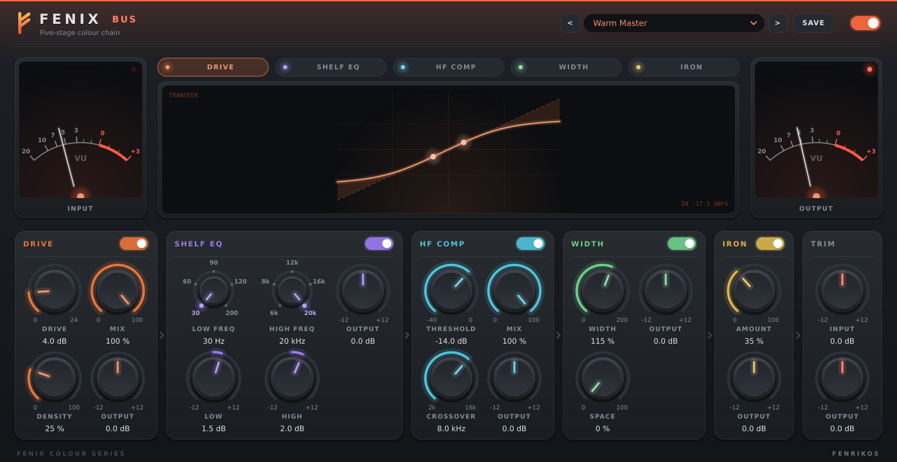
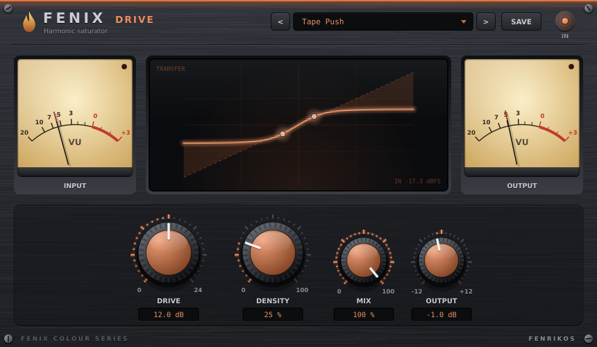
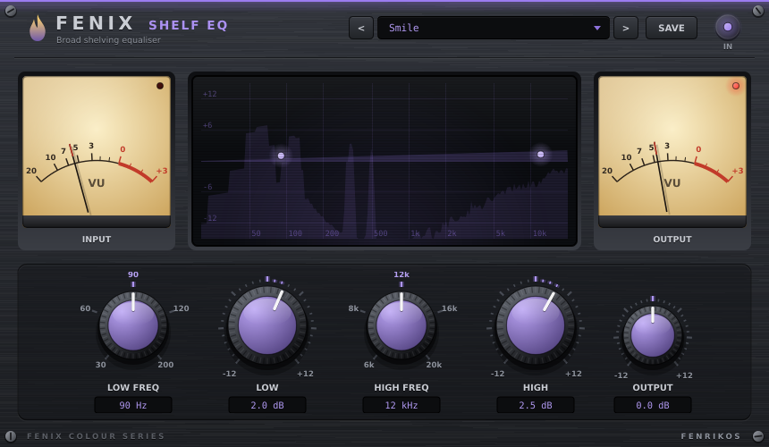
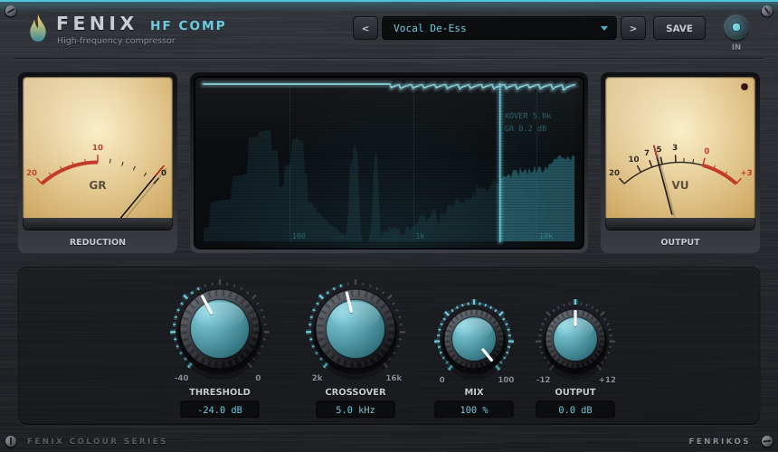
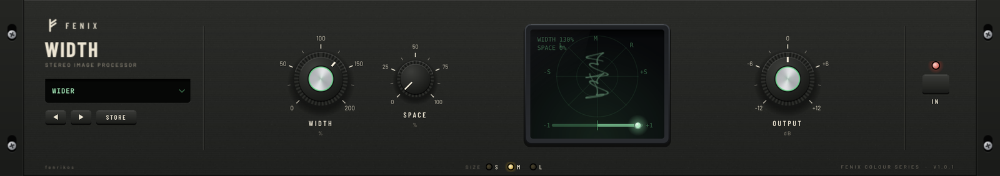
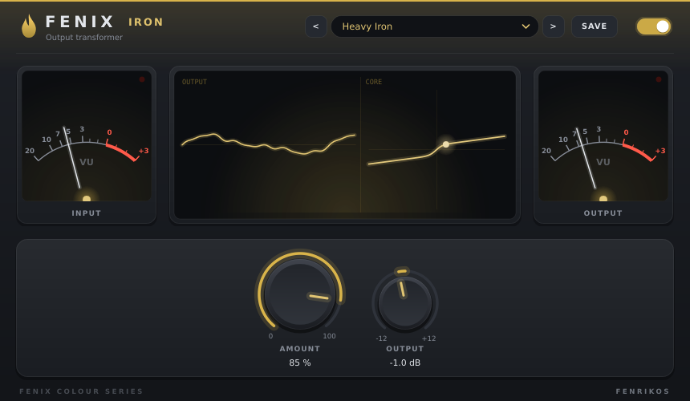

# Fenix

A suite of mix-bus colour processors by **fenrikos**, built with JUCE 8 for Windows, macOS and Linux
(VST3, AU on macOS, LV2 on Linux).
There are five single-stage plugins, each with its own live display, VU metering and factory presets, and
**Fenix Bus**, which runs all five stages in one chain with presets for the whole chain.



## Fenix Bus

All five stages in series: Drive → Shelf EQ → HF Comp → Width → Iron, then input and output trims.

- Each stage has its own **IN** switch. Switching a stage in or out crossfades against a latency-matched
  dry path, so it never clicks or shifts timing.
- The tabs above the display pick which stage's view is shown (clicking a card's title does the same).
- Combined presets such as *Warm Master*, *Drum Bus Glue*, *Vocal Sheen* or *Lo-Fi Crush* set every stage at once.
- Every stage runs the same code as its standalone plugin, so settings sound identical in both.

## The stages

| Plugin | What it does | Display |
|---|---|---|
| **Fenix Drive** | Level-dependent harmonic saturation. A variable-knee sigmoid with DC bias for even harmonics, level-compensated, 4x oversampled. | Live transfer curve, with dots tracking the input peak |
| **Fenix Shelf EQ** | Two broad shelves with stepped frequencies for tonal tilts. Low-Q shelves, 2x oversampled so the top shelf holds its shape up to 20 kHz. | EQ response over a real-time spectrum |
| **Fenix HF Comp** | Compresses only the band above the crossover. LR4 split, stereo-linked peak detector, 4:1 soft knee, fast attack. | Spectrum with the compressed band lit, scrolling gain-reduction history, GR needle meter |
| **Fenix Width** | Mid/side width, plus "Space": a low-frequency side lift (shuffler-style) for depth without a phasey top end. | Goniometer with phosphor persistence, correlation bar |
| **Fenix Iron** | Output transformer colour. Only the low band saturates (flux-dependent), with a small LF resonance and gentle HF softening. | Output scope and the core's magnetisation curve |

<p>
  
  
  
  
  
</p>

## Features

- **Presets.** Every plugin ships factory presets, which hosts also see as programs. Click the preset name for the
  full list, use the arrows to step through it, or **SAVE** your own. User presets go to
  `~/.config/fenrikos/Fenix/<plugin>/`; the menu can also delete them or open that folder.
- **Bypass.** The power switch crossfades to a latency-compensated dry path and is exposed as the host's bypass parameter.
- **Light on the UI thread.** Static artwork is cached and meters only repaint when their needles move, so the
  editor stays responsive alongside the 60 fps displays.
- Double-click any knob to reset it.

## Building

You need CMake ≥ 3.22, a C++20 compiler, a JUCE 8 checkout, and JUCE's Linux dependencies
(ALSA, FreeType, X11, Xrandr, Xinerama, Xcursor).

```sh
cmake -B build -DCMAKE_BUILD_TYPE=Release -DJUCE_DIR=/path/to/JUCE
cmake --build build -j
```

The built plugins are copied to `~/.vst3` and `~/.lv2` automatically. Link-time optimisation is on by default;
`-DFENIX_LTO=OFF` makes development builds link much faster.

### Releasing

The **Release builds** GitHub Actions workflow (`.github/workflows/release.yml`) builds, validates (pluginval,
plus auval for the AUs) and packages all three platforms; run it from the Actions tab and download the zips
from the run. macOS builds are ad-hoc signed unless Developer ID secrets are configured (see the workflow file).

For a local Linux release, `tools/build-portable.sh` builds the plugins inside an Ubuntu 22.04 container (needs Docker), so the binaries
only require glibc 2.35 rather than whatever the build machine runs, then packages them with the docs in
`packaging/` into `dist/Fenix-<version>-Linux-x64.zip`. `tools/store-art.py` turns 2x snapshots into store covers.

### Screenshots and paint benchmark

`-DFENIX_SNAPSHOTS=ON` also builds a `<Plugin>_snapshot` tool for each plugin. It runs the editor against
a synthetic mix and saves the result as a PNG, optionally with a factory preset loaded. `--bench` also prints
how long one full frame of the editor takes to paint:

```sh
./build/Bus_snapshot docs/bus.png 1 --bench
```

## Layout

```
common/          processor base (bypass, metering, presets), DSP helpers, look and feel, widgets, editor chrome
common/modules/  one header per stage: DSP, parameters, presets and display, shared by the plugins and the Bus
plugins/         thin standalone wrappers, plus Bus.cpp (chain processor and its faceplate)
tools/           editor snapshot tool
```

## Licence

Copyright (C) 2026 fenrikos.

Fenix is free software: you can redistribute it and/or modify it under the terms of the
[GNU Affero General Public License](LICENSE) as published by the Free Software Foundation, either
version 3 of the License, or (at your option) any later version. It is distributed in the hope that it
will be useful, but WITHOUT ANY WARRANTY; without even the implied warranty of MERCHANTABILITY or FITNESS
FOR A PARTICULAR PURPOSE.

Fenix uses [JUCE](https://juce.com) under the AGPLv3, the VST 3 SDK (MIT) and LV2 (ISC).
Ready-made builds for Windows, macOS and Linux are available pay-what-you-want on Gumroad.
